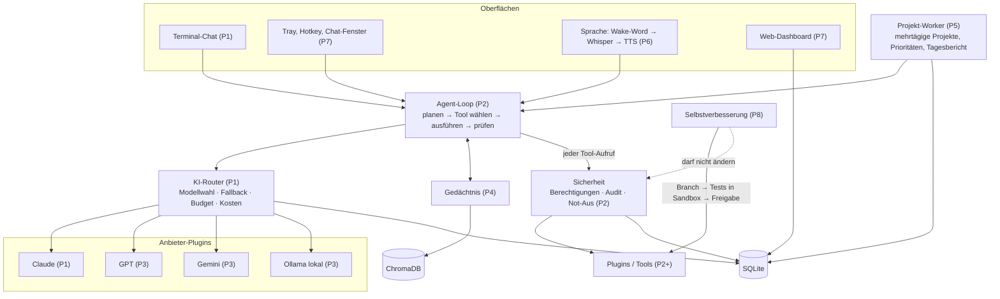

# JARVIS – Architektur

## Leitprinzipien

1. **Jede Phase ergibt ein lauffähiges Programm.** Neue Phasen ergänzen Module, statt
   bestehende Schnittstellen umzubauen.
2. **Sicherheit sitzt im Kern, nicht in der Oberfläche.** Budget-Sperren, Berechtigungen
   und Not-Aus greifen im Router bzw. vor jedem Tool-Aufruf – egal ob die Anfrage aus dem
   Chat, per Sprache oder aus einem Hintergrundprojekt kommt.
3. **Code und Daten sind getrennt.** Der Code liegt im Git-Repository (das JARVIS ab
   Phase 8 selbst verändern darf), alle Daten in `%LOCALAPPDATA%\Jarvis`.
4. **Alles ist ein Plugin**: KI-Anbieter, Tools, später Wake-Word- und TTS-Engines.

## Ordnerstruktur

`[P1]` = vorhanden, `[Pn]` = geplant in Phase n.

```text
Jarvis/
├── config.yaml                 Standardkonfiguration (eigene Werte: config.local.yaml)   [P1]
├── .env.example                Vorlage für API-Keys (besser: Credential Manager)         [P1]
├── pyproject.toml              Paket, Entry-Points, pytest/ruff/mypy                     [P1]
├── requirements.txt            Laufzeitpakete (requirements-dev.txt: + Testwerkzeuge)     [P1]
├── CHANGELOG.md                auch Protokoll der Selbstverbesserungen ab P8             [P1]
├── scripts/
│   ├── install.ps1             Installation unter Windows                                [P1]
│   ├── jarvis.cmd              Starter                                                   [P1]
│   └── autostart.ps1 …         Aufgabenplanung, Deinstallation                           [P5/P9]
├── docs/ARCHITECTURE.md        dieses Dokument                                           [P1]
├── tests/                      pytest, ohne Netzwerk und ohne API-Kosten                 [P1]
└── jarvis/
    ├── cli.py                  jarvis chat|ask|hw|models|cost|check|secrets              [P1]
    ├── core/
    │   ├── config.py           Laden + Validieren der Konfiguration                      [P1]
    │   ├── logging_setup.py    rotierende Logs, Schwärzung                               [P1]
    │   ├── db.py               SQLite mit Migrationen                                    [P1]
    │   ├── hardware.py         CPU/RAM/GPU/VRAM, Modell-Empfehlung                       [P1]
    │   ├── conversation.py     Kurzzeitgedächtnis                                        [P1]
    │   ├── app.py              verdrahtet alle Bausteine                                 [P1]
    │   ├── agent.py            Agent-Loop: planen → Tool → ausführen → prüfen            [P2]
    │   └── worker.py           Hintergrund-Worker für Projekte                           [P5]
    ├── router/
    │   ├── base.py             Datentypen + LLMProvider-Schnittstelle                    [P1]
    │   ├── registry.py         Anbieter-Plugins                                          [P1]
    │   ├── router.py           Modellwahl, Fallback, Budget, Kosten                      [P1]
    │   ├── costs.py            Preise, Verbrauch, Limits                                 [P1]
    │   ├── scoring.py          automatische Modellwahl (Qualität/Kosten/Tempo/Privat)    [P3]
    │   └── providers/          anthropic [P1] · openai, gemini, ollama [P3]
    ├── security/               darf von JARVIS selbst NIE verändert werden
    │   ├── secrets.py          .env + Windows Credential Manager                         [P1]
    │   ├── redaction.py        Secrets aus Logs entfernen                                [P1]
    │   ├── permissions.py      Stufen: auto / bestätigen / verboten                      [P2]
    │   ├── audit.py            vollständiges Aktionsprotokoll                            [P2]
    │   ├── killswitch.py       Not-Aus (Hotkey, CLI, Dashboard)                          [P2]
    │   └── integrity.py        Prüfsummen geschützter Dateien                            [P8]
    ├── plugins/                files, shell, apps, sysinfo [P2] · web, browser,
    │                           mail, calendar, reminders [P3+]
    ├── memory/                 ChromaDB-Langzeitgedächtnis, Fakten, Zusammenfassungen    [P4]
    ├── projects/               Ziele, Pläne, Aufgaben-Queue, Tagesberichte               [P5]
    ├── voice/                  Wake-Word, faster-whisper, Piper/ElevenLabs               [P6]
    ├── ui/                     terminal, render [P1] · tray, hotkeys, Fenster, Dashboard [P7]
    └── self_improve/           Git-Worktrees, Sandbox, Tests, Freigabe, Rollback         [P8]
```

Datenordner (`%LOCALAPPDATA%\Jarvis`): `jarvis.db`, `logs\`, `hardware.json`,
`chat_history.txt`; später `chroma\`, `projects\`, `sandbox\`, `reports\`.

## Zusammenspiel der Module



### Ablauf einer Chat-Nachricht (Phase 1)

1. `TerminalChat` hängt die Nachricht an die `Conversation` (Kurzzeitgedächtnis).
2. `ModelRouter.stream()` holt die Fallback-Kette der Aufgabenart aus `config.yaml`,
   überspringt nicht nutzbare Modelle (kein Key, deaktiviert, Anbieter gesperrt) und
   prüft vor jedem kostenpflichtigen Modell das Budget.
3. Das Anbieter-Plugin (`AnthropicProvider`) streamt die Antwort. SDK-Fehler werden in
   Router-Fehler übersetzt: *nicht erreichbar* → nächstes Modell; *ungültige Anfrage* →
   Abbruch; *Auth-Fehler* → Anbieter für die Sitzung sperren, nächstes Modell.
4. Nach Abschluss berechnet der Router die Kosten je tatsächlich genutztem Modell und
   schreibt sie in `model_usage` (SQLite). Abgebrochene Antworten werden geschätzt.
5. Die UI zeigt Text, Nutzungszeile und Hinweise (Fallback, Ablehnung, Budget).

Ab Phase 2 steht zwischen 1. und 2. der Agent-Loop, der eine Aufgabe in Teilschritte
zerlegt und für jeden Schritt eine Aufgabenart (und damit ein Modell) wählt.

## Wichtige Entscheidungen

| Entscheidung | Begründung |
|---|---|
| Ein Paket `jarvis/` statt loser Top-Level-Ordner | Namen wie `memory` oder `core` kollidieren sonst mit anderen Paketen; ermöglicht `python -m jarvis` und Entry-Points für Plugins. |
| Daten in `%LOCALAPPDATA%\Jarvis` | Selbstverbesserung arbeitet mit Git-Branches und Rollbacks – die dürfen nie Projekte, Gedächtnis oder Logs zurücksetzen. |
| Routing-Tabelle mit Fallback-Ketten in `config.yaml` | Nachvollziehbar und ohne Code änderbar. Phase 3 ergänzt automatisches Scoring hinter derselben Schnittstelle. |
| Budget-Sperre im Router | Kein Aufrufer (Chat, Projekt, Plugin) kann sie umgehen. Kostenlose lokale Modelle bleiben bei erreichtem Budget nutzbar. |
| Kein Fallback nach begonnener Ausgabe | Ein anderes Modell kann eine halbe Antwort nicht nahtlos fortsetzen; lieber klarer Fehler. |
| Streaming und Strg+C nur für die laufende Antwort | Lange Antworten sind sofort sichtbar; ein Abbruch beendet nicht das Programm und schließt die HTTP-Verbindung, damit keine weiteren Tokens anfallen. |
| Keys: Credential Manager bevorzugt, `.env` möglich | Kein Klartext auf der Platte nötig; `.env` bleibt für einfache Setups. Schwärzung kennt registrierte Werte und typische Key-Formate. |
| Claude: `effort` statt `temperature`, Prompt-Caching, Refusal-Fallback | Aktuelle Claude-Modelle lehnen `temperature` ab; `effort` steuert Qualität/Kosten. Der System-Prompt enthält nur das Datum (keine Uhrzeit), damit der Cache greift. |
| SQLite im WAL-Modus | Das Dashboard (P7) kann lesen, während Chat und Worker schreiben. |
| Pro Prozessrolle eine eigene Logdatei | Unter Windows sperren sich mehrere Prozesse sonst gegenseitig die Rotation. |

## Ehrliche Einschätzung riskanter Anforderungen

Diese Punkte setze ich um, aber anders als man naiv vermuten würde:

- **Windows-Dienst**: Dienste laufen in „Session 0“ ohne Desktop, Tray-Icon, Hotkeys und
  (praktisch) ohne Mikrofon. Besser: ein Benutzerprozess, der per **Aufgabenplanung bei
  der Anmeldung** startet (Phase 5/9). Er kann trotzdem im Hintergrund an Projekten
  weiterarbeiten.
- **„Sicherheitscode darf nicht verändert werden“**: Ein Prozess, der unter deinem Konto
  läuft, kann technisch jede Datei ändern, die du ändern kannst. Echter Schutz braucht
  mehrere Ebenen: (1) Selbstverbesserung arbeitet nur in einem Git-Worktree und jeder
  Diff, der `PROTECTED_PATHS` berührt, wird verworfen; (2) Prüfsummen der geschützten
  Dateien werden beim Start geprüft; (3) die Sandbox läuft in Docker bzw. Windows Sandbox
  ohne Schreibzugriff auf das Haupt-Repository; (4) optional schreibgeschützte NTFS-Rechte.
- **„Sandbox = separates venv“**: Ein venv trennt nur Pakete, nicht Dateisystem oder
  Netzwerk. Für generierten Code empfehle ich **Docker Desktop (WSL2)** oder Windows
  Sandbox; ein venv nur als Notlösung.
- **Pakete selbst installieren**: Gefahr durch Typosquatting/Schadpakete. Neue Pakete
  nur in der Sandbox, mit festgepinnter Version, und Übernahme ins Hauptsystem nur nach
  deiner Bestätigung.
- **Käufe**: Ich empfehle, Zahlungen nie zu automatisieren. JARVIS darf vorbereiten
  (Warenkorb, Vergleich), der Kauf selbst bleibt immer eine bestätigungspflichtige oder
  manuelle Aktion; Zahlungsdaten speichert JARVIS nicht.
- **Mehrtägige Autonomie**: Größtes Risiko sind Endlosschleifen und Kosten. Darum gibt es
  pro Projekt Budget, Schrittlimits, Checkpoints nach jedem Schritt und eine
  „Feststeck“-Erkennung, die dich fragt statt weiterzuprobieren.

## Sicherheitsmodell (Überblick über alle Phasen)

| Ebene | Mechanismus | Phase |
|---|---|---|
| Secrets | Credential Manager / `.env`, nie im Code, Schwärzung in Logs | 1 |
| Kosten | Tages-/Monatslimit im Router, Projektbudget, Pause + Rückfrage | 1 / 5 |
| Aktionen | Stufen *automatisch* (lesen, Systeminfo) · *Bestätigung* (löschen, Systemänderung, E-Mail senden, Admin, Käufe) · *verboten* | 2 |
| Nachvollziehbarkeit | Aktionsprotokoll in SQLite: wer, was, warum, Ergebnis | 2 |
| Not-Aus | globaler Hotkey + CLI + Dashboard; stoppt Agent-Loops, Projekte, laufende Prozesse | 2 / 7 |
| Selbstverbesserung | Branch/Worktree, Tests in Sandbox, Diff-Freigabe, Rollback, geschützte Pfade, Prüfsummen | 8 |
